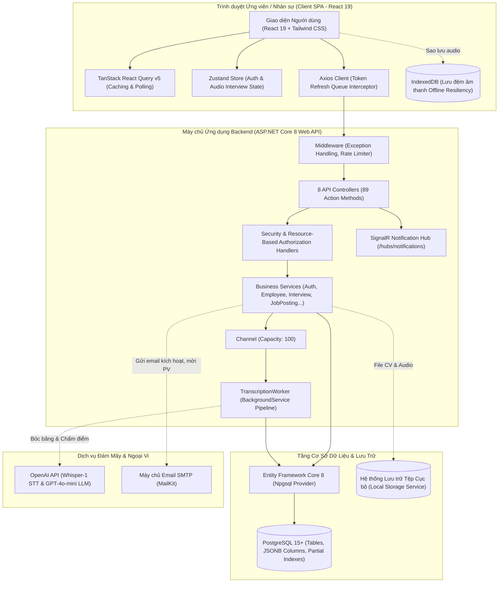
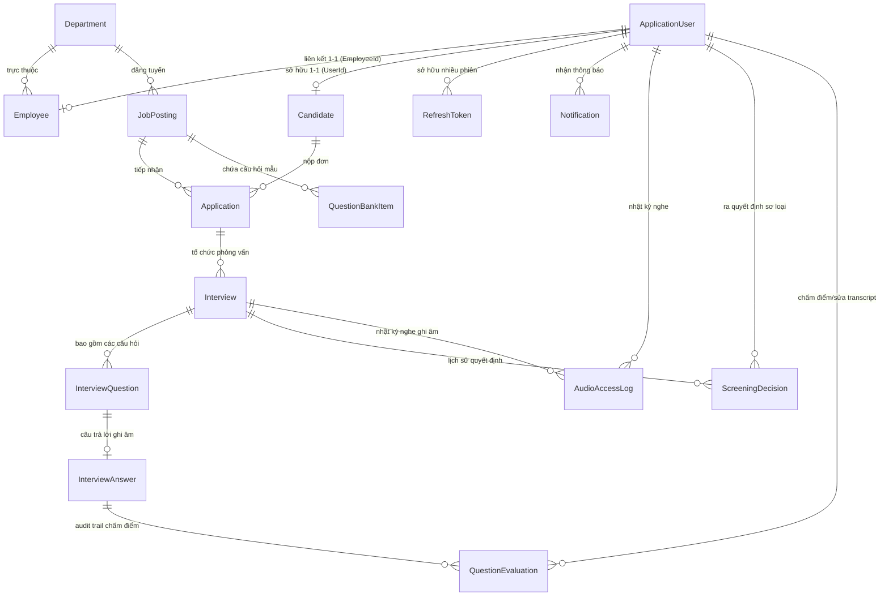

# EmployeeHRMS — Enterprise AI-Powered Human Resource Management System

[](https://dotnet.microsoft.com/)
[](https://react.dev/)
[](https://www.postgresql.org/)
[](https://openai.com/)
[](#7-hiện-trạng-kiểm-thử-testing--chất-lượng)
[](https://vitejs.dev/)

> **EmployeeHRMS** là hệ thống quản trị nhân sự toàn diện kết hợp trí tuệ nhân tạo (Full-Stack AI-Powered HRMS), hỗ trợ chu trình quản lý nhân sự khép kín từ khâu **tuyển dụng thông minh (Smart Recruitment & AI Audio Screening)** đến **quản trị nhân sự và cơ cấu phòng ban nội bộ (Core HRMS)**.

---

## MỤC LỤC
1. [Điểm Nổi Bật Của Hệ Thống](#1-điểm-nổi-bật-của-hệ-thống)
2. [Kiến Trúc Hệ Thống & Công Nghệ](#2-kiến-trúc-hệ-thống--công-nghệ)
3. [Các Phân Hệ Nghiệp Vụ Chính](#3-các-phân-hệ-nghiệp-vụ-chính)
4. [Mô Hình Dữ Liệu & Thực Thể (Database ERD)](#4-mô-hình-dữ-liệu--thực-thể-database-erd)
5. [Bảo Mật, Quyền Riêng Tư & Chống Gian Lận](#5-bảo-mật-quyền-riêng-tư--chống-gian-lận)
6. [Cấu Trúc Thư Mục Dự Án](#6-cấu-trúc-thư-mục-dự-án)
7. [Hiện Trạng Kiểm Thử (Testing & Chất Lượng)](#7-hiện-trạng-kiểm-thử-testing--chất-lượng)
8. [Hướng Dẫn Cài Đặt & Khởi Chạy Local](#8-hướng-dẫn-cài-đặt--khởi-chạy-local)
9. [Tài Khoản Mẫu & Thông Tin Kiểm Thử](#9-tài-khoản-mẫu--thông-tin-kiểm-thử)
10. [Ma Trận Phân Quyền (RBAC & Resource-Based Matrix)](#10-ma-trận-phân-quyền-rbac--resource-based-matrix)

---

## 1. Điểm Nổi Bật Của Hệ Thống

* 🚀 **Smart JD & Ngân hàng Câu hỏi Chuẩn hóa:** Soạn thảo bản mô tả công việc (Smart JD) 5 phần có cấu trúc qua LLM; tự động sinh bộ 3–5 câu hỏi phỏng vấn tình huống kèm barem chấm điểm Rubric 4 mức định lượng ngay khi phê duyệt tin tuyển dụng.
* 🎙️ **Phỏng vấn Ghi âm 1 Chiều Bất đồng bộ (Async Audio Interview):** Ứng viên thực hiện bài phỏng vấn trực tuyến qua liên kết định danh token một lần (`/interview/:token`), kiểm tra micro tại chỗ, và hoàn thành phần trả lời theo thời gian quy định cho từng câu hỏi.
* 🛡️ **Cơ chế Chống Gian Lận Toàn Diện (Anti-Cheat & Proctoring):**
  * **Khoá phiên độc quyền (`ActiveSessionNonce`):** Ngăn chặn mở đồng thời trên nhiều thiết bị hoặc nhiều tab.
  * **Ẩn trước câu hỏi (Question Masking):** Chỉ hiển thị nội dung câu hỏi hiện tại; mọi câu hỏi tiếp theo phía sau đều bị che rỗng để triệt tiêu lỗ hổng đọc đề trước rồi ngắt mạng suy nghĩ offline.
  * **Đóng dấu thời gian phát đề phía máy chủ (`ServedAt`):** Đo lường chính xác khoảng thời gian hoàn thành, tự động gắn cờ trễ hạn (`LateSubmission`) và hỗ trợ khôi phục bài nộp từ IndexedDB (`OfflineRecovery`).
  * **Giám sát phòng thi:** Ghi nhận số lần chuyển tab (`tabSwitchCount`), thời lượng rời màn hình (`outOfFocusDurationSeconds`), và cảnh báo ngắt kết nối micro (`flags`).
* 🤖 **Pipeline Xử Lý AI Ngầm Đa Tầng:**
  * Bóc băng giọng nói tự động bằng OpenAI **Whisper API** (`whisper-1`) kèm timestamps từng từ.
  * Tính toán chỉ số nhịp điệu phát âm: Tốc độ nói (**WPM**), tốc độ phát âm (**Articulation Rate**), thời lượng khoảng lặng và độ biến thiên nhịp dừng (**Pause Variation CV**).
  * Chấm điểm tự động qua **GPT-4o-mini Structured Outputs** với JSON Schema nghiêm ngặt.
  * Tích hợp bộ quét chống chèn mã chỉ thị (**Prompt Injection Scanner**) và xác thực trích dẫn bằng chứng có trong văn bản (**Evidence Quote Verifier**).
  * Tổng hợp điểm số trọng số kèm cửa chặn kỹ thuật (**Knockout Gate** — tự động dừng hoặc đánh giá loại nếu phát hiện câu hỏi cốt lõi đạt mức `Poor`).
* ⚖️ **Thẩm Định & Ra Quyết Định Sơ Loại Minh Bạch (Human-in-the-Loop):**
  * Cho phép HR/Interviewer nghe phát lại âm thanh phân đoạn (HTTP 206 Partial Content), hiệu chỉnh bản bóc băng với cơ chế phát hiện xung đột (`EditVersion`), và kích hoạt chấm lại 1-click (`Re-evaluate`).
  * Ghi nhận quyết định sơ loại bất biến (`ScreeningDecision`) theo mô hình append-only; bắt buộc giải trình (`overrideReason`) khi quyết định đi ngược lại gợi ý của AI.
  * Quyền xóa dữ liệu cá nhân theo quy định bảo vệ dữ liệu: làm sạch file âm thanh vật lý và nội dung bóc băng nhưng bảo tồn tính toàn vẹn của điểm số kiểm toán.
* 👥 **Quản Trị Nhân Sự & Phòng Ban Lõi (Core HRMS):** Quản lý hồ sơ nhân viên qua các trạng thái (Thử việc, Chính thức, Nghỉ phép, Thôi việc); quản lý phòng ban và cơ cấu tiền lương; quy trình onboarding chuyển tiếp ứng viên trúng tuyển thành nhân viên chính thức trong một giao dịch cơ sở dữ liệu nguyên tử (`Atomic Transaction`).

---

## 2. Kiến Trúc Hệ Thống & Công Nghệ

### 2.1 Sơ Đồ Kiến Trúc Tổng Thể



### 2.2 Công Nghệ Sử Dụng

| Thành phần | Công nghệ / Thư viện | Phiên bản | Ghi chú & Vai trò |
|---|---|---|---|
| **Backend Framework** | ASP.NET Core Web API | .NET 8.0 (LTS) | Kiến trúc 3 tầng: `Controllers -> Services -> DbContext` |
| **ORM / CSDL** | Entity Framework Core & Npgsql | 8.0.8 / 8.0.4 | Truy vấn LINQ, hỗ trợ Native JSONB và Partial Indexes |
| **Cơ sở Dữ liệu** | PostgreSQL | 15+ / 16 | Hệ quản trị CSDL quan hệ đối tượng |
| **Xác thực & Phiên** | JwtBearer & SHA-256 | 8.0.8 | JWT 15 phút, Refresh Token Rotation & Replay Detection |
| **Tích hợp Trí tuệ Nhân tạo** | OpenAI .NET SDK (Official) | 2.1.0-beta.2 | Whisper-1 (STT) và GPT-4o-mini (Smart JD & Structured Rubric) |
| **Xử lý Bất đồng bộ Ngầm** | `System.Threading.Channels` | .NET 8 Built-in | Hàng đợi Bounded Queue điều phối tiến trình bóc băng & chấm điểm |
| **Email Service** | MailKit | 4.7.1.1 | Gửi email kích hoạt, cấp lại mật khẩu và thư mời phỏng vấn |
| **Giao tiếp Thời gian thực** | ASP.NET Core SignalR | .NET 8 Built-in | WebSocket hub thông báo trạng thái hồ sơ và phân công |
| **Tài liệu Hóa API** | Swashbuckle (Swagger) | 6.6.2 | Khảo sát và tương tác endpoint tại `/swagger` |
| **Frontend Framework** | React | 19.2.8 | Single Page Application với React Router DOM v7 |
| **Build Tool / Bundler** | Vite | 8.2.2 | Môi trường phát triển và đóng gói tối ưu |
| **Quản lý Cache & API** | @tanstack/react-query | 5.102.8 | Caching, deduplication, và tự động polling thông minh |
| **Client State Management** | Zustand | 5.0.15 | Quản lý token, session nonce và tiến trình phỏng vấn |
| **Form & Schema Validation** | react-hook-form & zod | 7.86 / 3.25 | Kiểm tra dữ liệu đầu vào ngay từ phía client |
| **Realtime Client** | @microsoft/signalr | 10.0.11 | Kết nối WebSocket nhận thông báo đẩy tức thì |
| **Bộ Kiểm thử Tự động** | xUnit, Moq, FluentAssertions | Mới nhất | 362 ca kiểm thử tự động, độ bao phủ logic toàn diện |

---

## 3. Các Phân Hệ Nghiệp Vụ Chính

```
EmployeeHRMS
├── 1. Xác thực & Quản lý Phiên (Authentication & Session Security)
├── 2. Quản trị Nhân sự Lõi (Core Employee Management)
├── 3. Quản trị Phòng ban (Department Scoping)
├── 4. Tuyển dụng Thông minh & Ngân hàng Câu hỏi (Smart JD & Question Bank)
├── 5. Hồ sơ Ứng viên & Tiếp nhận Đơn ứng tuyển (Candidate & Application Pipeline)
├── 6. Cổng Phỏng vấn Ghi âm Sơ loại Trực tuyến (Async Audio Candidate Portal)
├── 7. Pipeline Bóc băng & Chấm điểm Tự động (AI Rubric Grading Pipeline)
├── 8. Thẩm định, Quyết định Sơ loại & Xóa Dữ liệu (HR Review & Screening Decisions)
└── 9. Trung tâm Thông báo Thời gian thực & Email (SignalR Notifications & MailKit)
```

1. **Xác thực & Phiên đăng nhập an toàn:**
   * Đăng ký tài khoản ứng viên kèm mã xác thực email 64 bytes ngẫu nhiên (băm SHA-256).
   * Giới hạn tối đa 5 phiên hoạt động đồng thời (**Session Capping**) với cơ chế soft-revoke.
   * Xoay vòng Refresh Token (**Token Rotation**) và phát hiện hành vi tái sử dụng trái phép (**Replay Attack Detection**) để thu hồi toàn bộ phiên.
2. **Quản trị Nhân sự (Core HR):**
   * Quản lý thông tin nhân viên, hợp đồng, chức vụ, mức lương và trạng thái làm việc.
   * Danh bạ đồng nghiệp cùng phòng ban có bảo vệ dữ liệu nhạy cảm (ẩn mức lương và trạng thái nội bộ đối với nhân viên thường).
   * Quy trình **Onboarding nguyên tử**: Tự động chuyển ứng viên trúng tuyển thành nhân sự mới, sinh mật khẩu ngẫu nhiên an toàn, gửi email chào đón và nâng cấp quyền hạn trong một transaction duy nhất.
3. **Tuyển dụng & Soạn thảo Smart JD:**
   * Soạn thảo tin tuyển dụng thông minh 5 phần (Giới thiệu, Trách nhiệm, Must-Have, Nice-To-Have, Quyền lợi) theo chuẩn JSONB.
   * Tính năng Quick Edit Step 2 hỗ trợ sửa nhanh tiêu đề, cấp bậc, hình thức làm việc, kỹ năng (TagInput) và nhập liệu tiền tệ có dấu phân cách hàng nghìn.
   * Duyệt tin tuyển dụng tự động kích hoạt sinh ngân hàng câu hỏi tình huống có barem điểm.
4. **Cổng Phỏng vấn Audio Ứng viên (Candidate Portal):**
   * Ứng viên thực hiện bài làm qua đường dẫn an toàn không cần đăng nhập (`/interview/:token`).
   * Kiểm tra thiết bị âm thanh và xác nhận cam kết trước khi vào thi.
   * Làm bài tuần tự 1 chiều với đồng hồ đếm ngược độc lập cho thời gian suy nghĩ và thời gian trả lời; lưu đệm âm thanh vào IndexedDB đề phòng rớt mạng giữa chừng.
5. **AI Pipeline & Thẩm định Sơ loại Tuyển dụng:**
   * Background Worker xử lý bóc băng và chấm điểm theo hàng đợi không phong tỏa (`Channel<T>`).
   * Phân tích chỉ số nhịp điệu phát âm (WPM, Articulation Rate, Pause Variation CV) phục vụ tham khảo (không tự động trừ điểm).
   * Chấm điểm bằng LLM bám sát Rubric 4 mức (Excellent, Good, Acceptable, Poor), trích xuất trích dẫn bằng chứng và phân tích ưu/nhược điểm.
   * Giao diện đánh giá đa chiều cho phép HR và Interviewer nghe lại âm thanh, sửa transcript, kích hoạt chấm lại và xác nhận quyết định sơ loại có lưu snapshot bằng chứng.

---

## 4. Mô Hình Dữ Liệu & Thực Thể (Database ERD)

Hệ thống bao gồm **15 Thực thể (Entities)** và **5 Đối tượng Giá trị (Value Objects)** được lưu trữ cấu trúc trên PostgreSQL:



* **5 Value Objects (JSONB):**
  * `JdContent`: Cấu trúc nội dung bản mô tả công việc.
  * `ScoringRubric`: Tiêu chí đánh giá 4 mức cho từng câu hỏi.
  * `SpeechMetrics`: Thông số nhịp điệu giọng nói (WPM, khoảng dừng, thời lượng phát âm).
  * `SalaryRange`: Khoảng lương tuyển dụng (Min, Max, Currency).
  * `QuestionEvaluationSnapshotItem`: Bản chụp trạng thái đánh giá tại thời điểm ra quyết định sơ loại.

---

## 5. Bảo Mật, Quyền Riêng Tư & Chống Gian Lận

| Lớp Bảo Mật | Cơ Chế Kỹ Thuật Triển Khai |
|---|---|
| **Chống Gian Lận Phòng Thi** | Khóa phiên theo `ActiveSessionNonce`, che câu hỏi sau (Question Masking), theo dõi mốc thời gian phát đề `ServedAt`, giám sát số lần chuyển tab và thời lượng mất focus. |
| **Xác Thực Đa Tầng** | Access Token JWT (15 phút) + Refresh Token băm `SHA-256`. Token Rotation, Replay Attack Detection, giới hạn tối đa 5 phiên/tài khoản. |
| **Phân Quyền Tài Nguyên (Resource-Based)** | Loại bỏ hoàn toàn lỗ hổng IDOR qua `CandidateAuthorizationHandler`, `EmployeeAuthorizationHandler`, và `InterviewAuthorizationHandler`. |
| **Kiểm Tra Tệp Tin Đa Lớp (4-Layer Validation)** | Giới hạn dung lượng (CV $\le$ 5MB, Audio $\le$ 25MB) $\rightarrow$ Whitelist phần mở rộng $\rightarrow$ MIME header $\rightarrow$ **Xác thực Magic Bytes** thực tế (giải nén ảo xác thực cấu trúc `[Content_Types].xml` của DOCX). |
| **Phòng Ngự Dữ Liệu AI** | Quét lỗ hổng chèn mã chỉ thị (**Prompt Injection Scanner**), đối chiếu trích dẫn bằng chứng có trong văn bản bóc băng (**Evidence Quote Verifier**). |
| **Quyền Riêng Tư & Xóa Dữ Liệu** | Hỗ trợ xóa vĩnh viễn file âm thanh vật lý và làm sạch bản bóc băng theo yêu cầu bảo vệ quyền riêng tư dữ liệu cá nhân, trong khi vẫn bảo lưu tính toàn vẹn của điểm số kiểm toán. |
| **Bảo Vệ Rò Rỉ Dữ Liệu (Scoping Audit)** | Tuyệt đối không để lộ barem điểm, tiêu chí đánh giá nội bộ, hay dữ liệu câu hỏi chưa tới lượt ra cổng thông tin của ứng viên. |

---

## 6. Cấu Trúc Thư Mục Dự Án

```
EmployeeHRMS/
├── server/                               # Dự án ASP.NET Core 8 Web API
│   ├── Controllers/                      # 8 API Controllers (89 Action Endpoints)
│   ├── Data/                             # AppDbContext, Cấu hình Fluent API, DataSeeder
│   ├── DTOs/                             # Data Transfer Objects cho Request và Response
│   ├── Helpers/                          # PagedResult, Whitelist Sort, ILike Extensions
│   ├── Hubs/                             # NotificationHub (SignalR WebSocket Hub)
│   ├── Middleware/                       # ExceptionHandlingMiddleware toàn cục
│   ├── Migrations/                       # 15 EF Core Migrations có snapshot đồng bộ
│   ├── Models/                           # 15 Entities & 5 Value Objects
│   ├── Security/                         # Resource-Based Authorization Handlers
│   ├── Services/                         # Business Logic & Background Worker
│   ├── Program.cs                        # Cấu hình DI, Middleware Pipeline & Rate Limiting
│   └── appsettings.json                  # Cấu hình JWT, OpenAI, PostgreSQL, SMTP
├── client/                               # Dự án Single Page Application (React 19 + Vite)
│   ├── src/
│   │   ├── api/                          # Axios Client, Interceptors, API Services
│   │   ├── components/                   # UI Components dùng chung (Button, Table, Modal...)
│   │   ├── context/                      # ThemeContext, SidebarContext
│   │   ├── features/                     # Feature-Sliced Modules:
│   │   │   ├── auth/                     # Đăng ký, đăng nhập, quên mật khẩu
│   │   │   ├── candidatePortal/          # Cổng phỏng vấn audio, mic check, indexedDB
│   │   │   ├── dashboard/                # Bảng điều khiển KPI & thống kê
│   │   │   ├── employees/                # Quản lý hồ sơ nhân viên, onboarding
│   │   │   ├── interviews/               # Danh sách phỏng vấn, thẩm định rubric, audio player
│   │   │   ├── notifications/            # Bảng tin thông báo thời gian thực SignalR
│   │   │   └── recruitment/              # Quản lý tin tuyển dụng, Smart JD, đơn ứng tuyển
│   │   ├── routes/                       # React Router v7 & ProtectedRoute Guards
│   │   └── main.jsx                      # Entrypoint ứng dụng
│   └── package.json                      # Cấu hình dependencies Frontend
├── tests/
│   └── EmployeeHRMS.Tests/               # Bộ kiểm thử tự động (xUnit, Moq, FluentAssertions)
├── docs/                                 # Tài liệu kỹ thuật chi tiết
│   ├── API_CONTRACT.md                   # Đặc tả giao diện 89 API endpoints & Schema Mapping
│   └── SYSTEM_SYNTHESIS.md               # Tài liệu kỹ thuật tổng hợp toàn diện đối chứng mã nguồn
└── AGENTS.md                             # Chuẩn mực kiến trúc, quy tắc phát triển & ranh giới
```

---

## 7. Hiện Trạng Kiểm Thử (Testing & Chất Lượng)

Dự án sở hữu bộ kiểm thử tự động chất lượng cao với **362 ca kiểm thử** bao phủ toàn bộ logic nghiệp vụ, bảo mật phiên, kiểm tra tệp tin, và quy trình AI:

```bash
cd tests/EmployeeHRMS.Tests
dotnet test
```

```
Test run for EmployeeHRMS.Tests.dll (.NETCoreApp,Version=v8.0)
Passed!  - Failed:     0, Passed:   362, Skipped:     0, Total:   362, Duration: 2 s
```

* **Phân bổ trọng tâm kiểm thử:**
  * **Bảo mật & Phiên:** Token Rotation, Replay Attack Detection, Session Capping, SHA-256 Hashing.
  * **Phân quyền Tài nguyên:** Ngăn chặn IDOR cho Ứng viên, Nhân viên và Người phỏng vấn.
  * **Kiểm tra Tệp tin:** Magic Bytes PDF/DOCX, giải nén ảo tệp nén, tệp âm thanh WebM/MP4.
  * **Chống gian lận & Phỏng vấn:** Cấp phát `ActiveSessionNonce`, đo mốc `ServedAt`, nộp bài tuần tự và cờ `LateSubmission`.
  * **AI Rubric Pipeline:** Structured Outputs, quét jailbreak prompt injection, đối chiếu trích dẫn bằng chứng, và cửa chặn Knockout Gate.

---

## 8. Hướng Dẫn Cài Đặt & Khởi Chạy Local

### 8.1 Yêu Cầu Môi Trường
* **.NET SDK:** Phiên bản `8.0` trở lên.
* **Node.js:** Phiên bản `18.x` hoặc `20.x` (kèm `npm`).
* **PostgreSQL:** Phiên bản `15+` đang hoạt động (cổng mặc định `5432`).
* **OpenAI API Key:** Khóa API có quyền truy cập mô hình `gpt-4o-mini` và `whisper-1`.

---

### 8.2 Cấu Hình Môi Trường

#### Bước 1: Cấu hình Backend (`server/appsettings.Development.json`)
Tạo hoặc hiệu chỉnh tệp cấu hình tại thư mục `server/`:

```json
{
  "ConnectionStrings": {
    "DefaultConnection": "Host=localhost;Port=5432;Database=EmployeeHRMSDb;Username=postgres;Password=your_postgres_password"
  },
  "JwtSettings": {
    "Secret": "A_VERY_SECURE_SECRET_KEY_AT_LEAST_32_CHARACTERS_LONG_123456",
    "Issuer": "EmployeeHRMS",
    "Audience": "EmployeeHRMSClient",
    "AccessTokenExpirationMinutes": 15,
    "RefreshTokenExpirationDays": 7,
    "MaxActiveSessionsPerUser": 5
  },
  "OpenAISettings": {
    "ApiKey": "sk-proj-your_openai_api_key_here",
    "Model": "gpt-4o-mini",
    "WhisperModel": "whisper-1"
  },
  "EmailSettings": {
    "SmtpHost": "smtp.gmail.com",
    "SmtpPort": 587,
    "SenderEmail": "your_email@gmail.com",
    "SenderPassword": "your_app_specific_password",
    "FrontendBaseUrl": "http://localhost:5173"
  },
  "AudioInterview": {
    "BaseCandidatePortalUrl": "http://localhost:5173/interview"
  }
}
```

#### Bước 2: Cấu hình Frontend Client (`client/.env`)
Tạo tệp `.env` tại thư mục `client/`:

```env
VITE_API_URL=http://localhost:5167/api
VITE_SIGNALR_URL=http://localhost:5167/hubs/notifications
```

---

### 8.3 Khởi Chạy Hệ Thống

#### 1. Cập nhật Cơ sở Dữ liệu (Database Migration & Seeding)
Tại thư mục gốc dự án:
```bash
cd server
dotnet ef database update
```
*(Hệ thống sẽ tự động khởi tạo cơ sở dữ liệu `EmployeeHRMSDb` và tạo tài khoản Quản trị viên mặc định).*

#### 2. Khởi động Máy chủ Backend (.NET 8 Web API)
```bash
cd server
dotnet run
```
* **API Endpoint:** `http://localhost:5167`
* **Tài liệu Swagger:** `http://localhost:5167/swagger`

#### 3. Khởi động Giao diện Frontend (React SPA)
Mở một cửa sổ dòng lệnh khác:
```bash
cd client
npm install
npm run dev
```
* **Ứng dụng Web:** `http://localhost:5173`

---

## 9. Tài Khoản Mẫu & Thông Tin Kiểm Thử

Hệ thống được khởi tạo sẵn tài khoản Quản trị viên cao nhất:

| Vai trò | Email Đăng Nhập | Mật Khẩu Mặc Định | Mô Tả Quyền Hạn |
|---|---|---|---|
| **Admin** | `admin@hrms.com` | `Admin@123` | Toàn quyền quản trị hệ thống, phòng ban, duyệt tin, phân công và xóa dữ liệu |

*💡 Để trải nghiệm các vai trò khác:*
* **HR / Interviewer:** Đăng nhập tài khoản `Admin` để tạo nhân sự và cấp tài khoản qua màn hình Quản lý Nhân viên.
* **Candidate (Ứng viên):** Tự do đăng ký tài khoản mới trực tiếp tại màn hình Đăng ký (`/register`).

---

## 10. Ma Trận Phân Quyền (RBAC & Resource-Based Matrix)

| Khu Vực / Module | Admin | HR | Interviewer | Employee | Candidate | Khách (Ẩn danh) |
|---|:---:|:---:|:---:|:---:|:---:|:---:|
| **Xác thực & Đăng nhập** | ✅ | ✅ | ✅ | ✅ | ✅ | ✅ |
| **Quản lý Nhân sự (Danh sách/CRUD)** | ✅ | ✅ | ❌ | ❌ | ❌ | ❌ |
| **Hồ sơ Cá nhân (`/profile`)** | ✅ | ✅ | ✅ | ✅ Chỉ mình | ❌ | ❌ |
| **Danh bạ Đồng nghiệp (`/my-department`)** | ✅ | ✅ | ✅ | ✅ Ẩn lương/Status | ❌ | ❌ |
| **Phòng ban (Danh sách công khai)** | ✅ | ✅ | ✅ | ✅ | ✅ | ✅ Tên phòng |
| **Tin tuyển dụng (Tạo / Duyệt / Smart JD)** | ✅ | ✅ | ❌ | ❌ | ❌ | ❌ |
| **Tin tuyển dụng công khai** | ✅ | ✅ | ✅ | ✅ | ✅ Published | ✅ Published |
| **Nộp đơn ứng tuyển (`/jobs/:id/apply`)** | ❌ | ❌ | ❌ | ❌ | ✅ Chỉ mình | ❌ Cần login |
| **Cổng phỏng vấn Audio (`/interview/:token`)** | ❌ | ❌ | ❌ | ❌ | ✅ Token sở hữu | ✅ Token sở hữu |
| **Bảng điều khiển Sơ loại Phỏng vấn** | ✅ | ✅ | ✅ Hồ sơ phân công | ❌ | ❌ | ❌ |
| **Nghe phát lại Audio & Sửa Transcript** | ✅ | ✅ | ✅ Hồ sơ phân công | ❌ | ❌ | ❌ |
| **Quyết định Sơ loại Tuyển dụng** | ✅ | ✅ | ❌ Chỉ xem | ❌ | ❌ | ❌ |
| **Xóa Dữ liệu Cá nhân (Privacy)** | ✅ | ✅ | ❌ | ❌ | ❌ | ❌ |

---

## 📄 Bản Quyền & Giấy Phép
Dự án được xây dựng và phát triển phục vụ mục đích học tập, nghiên cứu và báo cáo kết quả cuối cùng của đợt thực tập của tôi.
Mọi thông tin chi tiết xin vui lòng tham khảo các tài liệu tại thư mục [`docs/`]*sẽ được cập nhật trong thời gian sớm nhất*.

